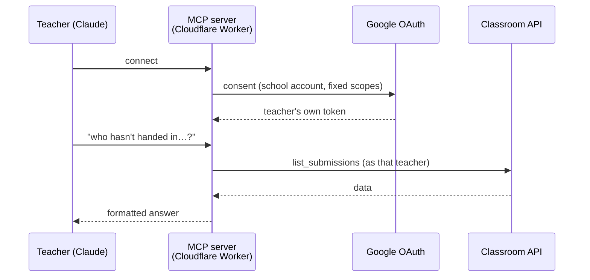

# Google Classroom MCP Connector

**Lets teachers work with their own Google Classroom from inside Claude:
ask questions about their classes and set work, safely.**

Built for BC Academy International School, Dubai, because no Google Classroom
connector existed in the Claude connector registry.

> **Private source.** The code runs in a school deployment, so this repo explains the design instead.

---

## What teachers can do

Ask in plain English:

- *"Which of my Year 8 class haven't handed in the photosynthesis assignment?"*
- *"Show me everything I've got outstanding to mark this week."*
- *"Who submitted the essay late, and how late?"*

And set work:

- *"Set that comprehension task for Year 6 English, due Thursday 4pm, 20 marks."*
- *"Post the revision list I just wrote to Year 8 Science as a draft."*

Combined with the school's Claude skills for marking and reports, a teacher can go
from *"pull my class's last three assignment grades"* straight to drafting report
comments, with no manual exports.

## 15 tools

| Read | Create |
|---|---|
| `list_my_classes` · `get_class` · `list_class_students` · `list_class_teachers` · `list_topics` · `list_assignments` · `get_assignment` · `list_submissions` · `list_announcements` · `list_class_materials` · `get_pupil_profile` · `list_pupil_guardians` | `create_assignment` · `create_announcement` · `create_class_material` |

## Design: safe by default

This touches children's classes, so the rules are strict:

| Principle | How |
|---|---|
| **Per-teacher access** | Each teacher signs in with their own school Google account (OAuth 2.0). No service account and no domain-wide delegation, so a teacher can only ever reach classes they teach. |
| **Drafts by default** | Everything created is an unpublished draft, invisible to pupils, unless the teacher explicitly asks to publish. |
| **No edits or deletes** | The API layer refuses PATCH, PUT and DELETE outright, even on work the connector created itself. No grading tools. |
| **Auditable scopes** | One file is the complete answer to "what can this see?". Incremental auth is off, so a removed scope is really removed. |
| **School accounts only** | Personal Google accounts are refused by domain allow-list. |
| **Emergency brake** | A Workspace admin can block the OAuth client and cut all access instantly, with no redeploy. |

## Architecture

**Stack:** TypeScript · Cloudflare Workers · Model Context Protocol (MCP) ·
Google OAuth 2.0 · Google Classroom API · ~2,500 lines · unit tests for the API
client, consent flow and formatting.

## My role

Designed and built it end to end: the permission model,
the OAuth flow, the tools, tests and deployment.

---

[@ayaz-oss](https://github.com/ayaz-oss)
